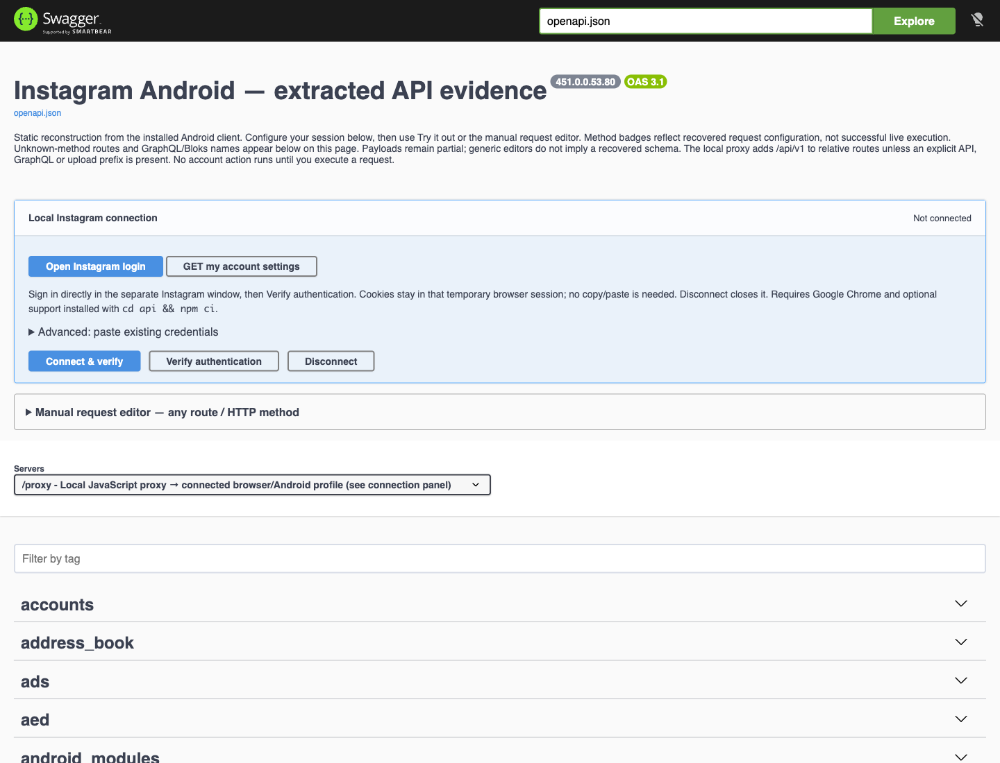

# Mobile App API Workbench

A workspace for reverse-engineered mobile app research, evidence, and local API tooling. The repository retains its existing `instagram-api-workbench` GitHub URL.

| App | Directory | Status |
| --- | --- | --- |
| Instagram | [apps/instagram/](apps/instagram/) | Existing workbench, analysis scripts, and evidence |
| Snapchat | [apps/snapchat/](apps/snapchat/) | Research in progress: selected DEX/gRPC and native-bridge traces |
| Discord | [apps/discord/](apps/discord/) | Research in progress: provisional Hermes bytecode traces |
| TikTok | [apps/tiktok/](apps/tiktok/) | Research in progress: three statically traced GET declarations |
| Roblox | [apps/roblox/](apps/roblox/) | Research in progress: selected ARM64 native-code references |

Each app owns its tooling, dependencies, documentation, evidence, and local analysis inputs. Instagram-specific code remains in its app directory; no shared runtime is introduced yet.

## Start here

**Instagram has a usable local workbench today. Snapchat, Discord, TikTok, and Roblox have research artifacts and reproduction scripts; they do not yet have usable API workbenches or runtime-verified integrations.** Recovered client routes are research evidence, not guaranteed working endpoints. Authentication does not establish access to every operation.

| I want to… | Start here | Requirements |
| --- | --- | --- |
| Browse the API catalog | [Open the hosted Swagger catalog](https://ig.beehivewebstudio.com/swagger.html) | A browser; no account or installation |
| Run the Instagram workbench locally | Follow the commands below | Git and Node.js 20.11+ |
| Analyze my own APK | [APK reproduction guide](apps/instagram/docs/REPRODUCING.md) and [version porting guide](apps/instagram/docs/PORTING.md) | Python 3.10+, Node.js/npm, your own APKs; additional tools for device acquisition or decompilation |

See the [multi-app research notes](docs/DEEP_ANALYSIS.md) for findings, tool requirements and current limits. Discord's Hermes results remain provisional because of the decoder compatibility warning. APKs are not distributed; reproducing analysis requires your own matching inputs.

## Run locally

In a terminal, run:

```sh
git clone https://github.com/kernelpanic0x11/instagram-api-workbench.git
cd instagram-api-workbench/apps/instagram/api
node server.mjs
```

Already cloned? From the repository root, run `cd apps/instagram/api`, then `node server.mjs`.

Open **http://127.0.0.1:8766/**. Vendored browser assets and the server's built-in runtime support browsing without `npm install`. You do not need REA, JADX, an APK, or Instagram credentials to explore the catalog. Stop the server with **Ctrl+C**.



*Local workbench with no account connected. No live account data is shown.*

### Your first walkthrough

1. Launch the server and open the local address above.
2. Use **Filter by tag** to find an area such as `accounts`, then expand the tag and an operation.
3. Read the operation description and evidence references. Method badges describe recovered client configuration; generic request editors are not recovered payload schemas.
4. Explore without connecting an account. **Try it out** opens an editor; **Execute** sends a request. Mutating requests can change an account when authenticated.
5. If you want authenticated execution, follow the [Instagram connection guide](apps/instagram/README.md#run). Browser login additionally requires Google Chrome and `npm ci` run in `apps/instagram/api`. Sign in only in the separate Instagram window.

The [Instagram guide](apps/instagram/README.md) covers manual sessions, extraction counts, limitations, and development. Keep the local server on your own machine; see [security notes](apps/instagram/SECURITY.md).

### Common setup questions

| Symptom | Next step |
| --- | --- |
| `node` is not found | Install Node.js 20.11 or later, reopen the terminal, and check `node --version`. |
| `Cannot find module ... server.mjs` | Run from `apps/instagram/api/`, not the repository root. |
| `EADDRINUSE` on port 8766 | A process already uses that port. Check whether the workbench is already running before starting another copy. |
| Browser login helper is unavailable | Run `npm ci` inside `apps/instagram/api` and ensure Google Chrome is installed. Catalog browsing needs neither. |
| An API request fails | Review authentication, app version, request context, and operation evidence. A recovered route may require unsupported headers, signing, permissions, or challenge completion. |

The [REA web application](web/README.md) lives in `web/`: an AstroWind interface, Cognito-backed service, isolated analysis worker, and AWS templates. Its setup and verification status are documented separately from the app-specific research workbenches.

## Contribute or get help

To continue the research with an AI coding agent, copy this prompt and specify an app and feature:

```text
Help me extend this repository's reverse-engineering research.
Target app: [Instagram / Snapchat / Discord / TikTok / Roblox]
Target feature or question: [describe one concrete investigation]

Read AGENTS.md, CONTRIBUTING.md, the target app's README, and
docs/DEEP_ANALYSIS.md before making changes. Inspect existing evidence and
scripts, then summarize what is established and what remains unknown.

Keep all app-specific findings under apps/<app>/. Use only APKs I provide
or acquire from my authorized device. Verify input versions and hashes;
do not reuse obfuscated selectors or mappings across different APKs.

Start with static analysis. Follow selected candidates through callers,
request construction and serialization. Record exact source locations and
hashes. Keep lexical candidates, statically traced declarations, runtime
observations and successfully exercised requests distinct. Do not infer
HTTP methods or payload schemas from route names or nearby strings.

Do not read account storage, log in, instrument my device, send API
requests or change account state without agreeing on that runtime task
with me first. Keep APKs, raw captures, credentials, device identifiers,
personal details and identifying paths out of Git. Use synthetic tests.

Implement one bounded, reproducible improvement. Run the relevant tests
and public artifact scan; document the findings, unresolved questions and
next step. Before committing or publishing, verify both Git author and
committer use the public identity required by AGENTS.md. Commit the work
locally and report the commit hash; push only when I ask.
```

Use the [issue templates](https://github.com/kernelpanic0x11/instagram-api-workbench/issues/new/choose) for bugs, setup questions, or research requests. Include the app/version, exact command, expected behavior, and a redacted error. Never include session cookies, tokens, account responses, or device identifiers. Read [CONTRIBUTING.md](CONTRIBUTING.md) before submitting changes.

GitHub Actions runs the existing JavaScript tests, scanner and reproduction tests, OpenAPI build/validation, and repository-wide public artifact scan. These checks use synthetic inputs and do not log into Instagram or need APKs.

To run the same checks locally from the repository root:

```sh
npm ci --ignore-scripts --prefix apps/instagram/api
npm run build --prefix apps/instagram/api
npm run validate --prefix apps/instagram/api
npm test --prefix apps/instagram/api
python3 apps/instagram/api/bulk-trace/test_extract.py
python3 apps/instagram/scripts/test_reproduce.py
python3 scripts/test_analyze_apks.py
python3 scripts/test_deep_traces.py
python3 scripts/check-public.py
```

The original Instagram reverse-engineering work used [REA (Reverse Engineer Anything)](https://github.com/morluto/rea) by [morluto and contributors](https://github.com/morluto/rea/graphs/contributors), alongside JADX and custom DEX analysis scripts. Credit to the REA project for the analysis tooling that supported this research.

Original code is MIT licensed; app evidence and bundled dependencies retain their own rights. See [LICENSE](LICENSE) and each app's notices.
